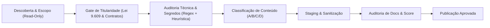

# Agentic Forge ⚒️

> **Repositório central de habilidades modulares, runbooks de engenharia e ferramentas de governança para agentes de inteligência artificial autônomos.**

[](./LICENSE)
[](#compatibilidade)
[](#auditoria-e-qualidade)
[](#catálogo-de-skills)

---

## 🧭 Visão Geral

O **Agentic Forge** é o laboratório e repositório de habilidades (*skills*) desenvolvidas para expandir o raciocínio, a segurança e a capacidade operacional de agentes autônomos (como Google Antigravity e assistentes compatíveis com o ecossistema Gemini CLI).

Cada habilidade contida neste ecossistema é projetada com quatro pilares inegociáveis:
1. **Engenharia Defensiva:** Operação em modo estritamente *read-only* por padrão, sem efeitos colaterais silenciosos.
2. **Aprovação por Etapas (Human-in-the-loop):** Ações com impacto relevante exigem autorização explícita.
3. **Degradação Segura:** Ausência de ferramenta ou contexto incompleto resulta em `NOT RUN`, nunca em falso positivo de conformidade.
4. **Independência Operacional:** Scripts nativos construídos prioritariamente sobre a biblioteca padrão do Python, sem dependências externas obrigatórias.

---

## 🗂️ Catálogo de Skills

| Skill | Versão | Status | Descrição | Diretório |
|---|---|---|---|---|
| **[Showcase Engineer](#-destaque-showcase-engineer)** | `v1.0.0` | 🟢 Estável | Audita, prepara, sanitiza e gera showcases públicos de projetos no GitHub com controle rigoroso de propriedade intelectual e segredos. | [`skills/showcase-engineer`](./skills/showcase-engineer) |
| *Novas skills em forja...* | — | 🟡 Em planejamento | Em breve novas capacidades de engenharia reversa, benchmarking e migração assistida. | — |

---

## 🌟 Destaque: Showcase Engineer

A primeira habilidade integrada à forja é a **Showcase Engineer** (`showcase-engineer`).

Projetada para desenvolvedores e pesquisadores que desejam demonstrar suas criações profissionalmente sem incorrer no erro de expor código de produção, credenciais, histórico sujo ou infraestrutura sensível de clientes/empresas.

### 🛡️ Matriz de Auditoria e Portais de Validação



### 📋 Capacidades do CLI Integrado

A skill inclui utilitário nativo em Python (`showcase.py`) com zero dependências externas:

```bash
# 1. Inspecionar volume e tipos de arquivo de um projeto
python skills/showcase-engineer/scripts/showcase.py inspect /caminho/do/projeto

# 2. Executar auditoria completa com cálculo de Quality Score
python skills/showcase-engineer/scripts/showcase.py audit /caminho/do/projeto

# 3. Auditoria estrutural de documentação e links internos
python skills/showcase-engineer/scripts/showcase.py validate-docs /caminho/do/projeto

# 4. Inspecionar referências e caminhos históricos no Git
python skills/showcase-engineer/scripts/showcase.py audit-git /caminho/do/projeto
```

### 📊 Sistema de Pontuação (Quality Score)

A avaliação segue pesos bem calibrados, onde verificações não executadas permanecem sem pontuação:
- **Segurança e Privacidade:** 30 pontos (rastreamento de credenciais, chaves e dados pessoais/LGPD).
- **Documentação e Links:** 20 pontos (README informativo, ausência de placeholders e consistência).
- **Evidência Técnica & Testes:** 20 pontos.
- **Apresentação Visual:** 15 pontos.
- **Reprodutibilidade & Estrutura:** 15 pontos (arquivos essenciais, setup e acessibilidade).

---

## 📁 Estrutura do Repositório

```text
agentic-forge/
├── .gitignore
├── LICENSE
├── README.md
└── skills/
    └── showcase-engineer/
        ├── SKILL.md             # Contrato de instruções e workflow do agente
        ├── README.md            # Documentação técnica específica da skill
        ├── checklists/          # Checklists operacionais de segurança e publicação
        ├── scoring/             # Critérios de pontuação e bloqueios obrigatórios
        ├── templates/           # Modelos de Threat Model, SBOM e relatórios
        ├── workflows/           # Procedimentos passo a passo
        └── scripts/             # CLI e suíte de validação em Python nativo
            ├── showcase.py
            ├── analyzers/
            ├── validators/
            └── tests/
```

---

## 🚀 Como Instalar e Usar no Antigravity

### Opção 1: Por Projeto (Workspace Local)
Copie a skill desejada para a pasta `.agents/skills/` do seu projeto:

```bash
mkdir -p .agents/skills
cp -r skills/showcase-engineer .agents/skills/
```

### Opção 2: Globalmente na Máquina
Para disponibilizar a skill para qualquer projeto em seu ambiente local:

```bash
mkdir -p ~/.gemini/skills
cp -r skills/showcase-engineer ~/.gemini/skills/
```

O agente identificará a habilidade automaticamente através do arquivo `SKILL.md` e a ativará sob demanda quando você solicitar a criação ou revisão de showcases.

---

## 🧪 Testes e Verificação

Para executar a suíte de testes de qualquer skill:

```bash
python -m unittest discover -s skills/showcase-engineer/scripts/tests
```

---

## 📄 Licença

Distribuído sob a licença **MIT**. Consulte o arquivo [LICENSE](./LICENSE) para obter detalhes.

---

**Desenvolvido com foco em excelência e segurança operacional para a era agêntica.**
